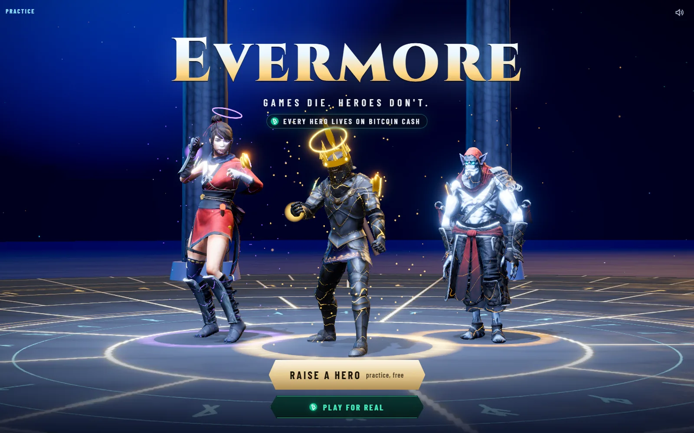
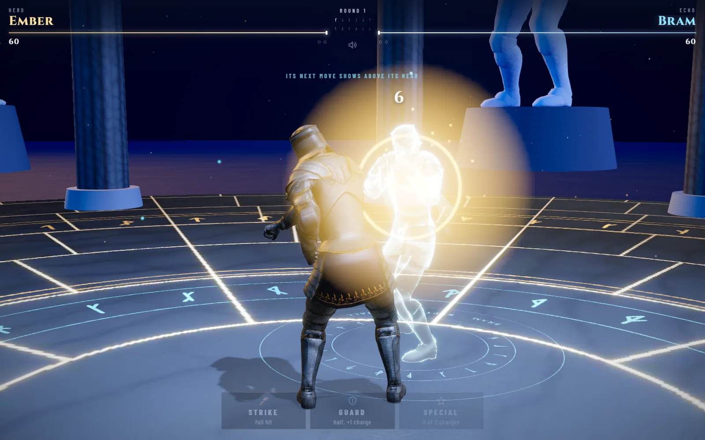
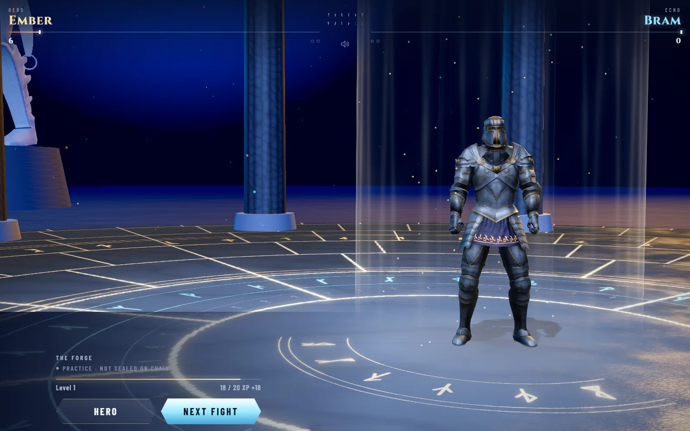

<p align="center">
  
</p>

<h1 align="center">Evermore</h1>

<p align="center"><b>Games die. Heroes don't.</b><br/>A 3D hero duel game where every hero lives on Bitcoin Cash.</p>

<p align="center">
  <a href="https://evermore-alpha-nine.vercel.app"></a>
  <a href="https://evermore-alpha-nine.vercel.app/proof"></a>
  
  
  
</p>

<p align="center">
  <a href="https://evermore-alpha-nine.vercel.app">Play</a> ·
  <a href="https://evermore-alpha-nine.vercel.app/proof">Proof on chain</a> ·
  <a href="https://blockchair.com/bitcoin-cash/transaction/1dcafe2bc8d5b061503b17db790740eda1544c5fac98c4e228c4028a897784fd">Genesis tx</a>
</p>

---

## Why it exists

Games shut down and take everything players earned with them. The Crew went dark in April 2024 and every copy stopped working. Concord was pulled two weeks after launch. Anthem's servers went off in January 2026. More than 1.29 million Europeans signed Stop Killing Games to ask for a fix.

Evermore is the fix for one game. Your hero is a CashToken in your own wallet. The rules that level it up are Bitcoin Cash contracts. There is no server of ours to switch off.

## How it plays

| | |
|---|---|
| **Raise** | Mint a Knight, Rogue or Mage for about 25 cents. Level, XP and stats live inside the token. |
| **Challenge** | The arena is full of echoes: other players' heroes, fighting on their own. Pick one. A 2 cent fee goes straight to its keeper. |
| **Duel** | Turn based. Strike, Guard or Special each round. The echo fights with a style you can read before you pay. |
| **Forge** | Win and the chain replays your moves. Only then does your hero gain XP and level up. Beat an echo 3 levels above you and gear drops, from a supply capped at 5,000 forever. |
| **Earn while away** | Your hero is an echo too. Every challenge against it pays you, even while you sleep. |
| **Trade** | List any hero or gear at your price. Hero and money swap in one transaction, with no marketplace in the middle. |

No seasons, no resets. One arena that never closes.

<p align="center">
  
  
</p>

## Judge fast path (five minutes)

1. Open **https://evermore-alpha-nine.vercel.app** and press **Play now**. Practice runs fully in your browser, free, no wallet.
2. Raise a hero, challenge an echo, win a duel, watch the forge.
3. Press **Play for real**. Scan the QR with Selene, Cashonize or Paytaca (WizardConnect). Approve one small payment to fund your play Satchel.
4. Raise, challenge and forge again. Each step opens a real mainnet transaction on the explorer. No wallet popups mid fight.
5. Press **Send home**. The hero lands in your wallet with its art (BCMR).
6. Open **/proof**. Every number there is read live from Bitcoin Cash by your browser.

## How Bitcoin Cash does the work

| Bitcoin Cash feature | What it does in Evermore |
|---|---|
| CashTokens commitments | The hero token is the save file: class, level, XP, HP, ATK, DEF, SPD, wins. |
| 2026 VM loops and functions | The forge contract replays the whole duel, up to 12 rounds, before any level is written. A fake win fails on chain. |
| Covenants | The challenge fee must pay the echo's keeper. Mint and forge fees must pay the treasury. No output, no transaction. |
| Spend and recreate | An echo is spent and recreated with its counters raised, so anyone can fight it while its owner is offline. |
| Minting tokens with a counter | 16 parallel forge lanes so players never collide; a gear counter that refuses to pass its cap. |
| P2SH32 | Big enough unlocking data for a full move list under the VM's cost budget. |
| Fast, cheap transactions | A duel costs under a cent in network fees and confirms at the speed of play. |

## Architecture

```
  browser (static site)                         Bitcoin Cash mainnet
 ┌──────────────────────────────┐            ┌──────────────────────────────┐
 │ 3D client (Three.js)         │            │ Lane x16   raise, challenge, │
 │ duel sim (same rules as      │  Electrum  │            forge, sync       │
 │   the covenant)              │◀──────────▶│ Arena      echoes (ghosts)   │
 │ sdk: tx builders, reads      │  WebSocket │ Counter    gear supply cap   │
 │ Satchel (play key)           │            │ Sale       atomic hero swap  │
 └──────────────┬───────────────┘            └──────────────────────────────┘
                │ WizardConnect (sign only)
        Selene / Cashonize / Paytaca
```

- `contracts/` CashScript sources, compiled artifacts, 104 VM tests, deploy scripts.
- `sdk/` duel rules, commitment codecs, transaction builders, chain reads.
- `web/` the game, the landing page and /proof.

## Proof

| Claim | Receipt |
|---|---|
| Live on mainnet | [Genesis tx](https://blockchair.com/bitcoin-cash/transaction/1dcafe2bc8d5b061503b17db790740eda1544c5fac98c4e228c4028a897784fd), category `8941559b1d6823277392ecf0b3d523829a976002b02eee51be64496423dbe480` |
| Levels are earned | Each echo on /proof links its latest fight on mainnet. A fake move list is rejected: [test](contracts/test/forge.test.mjs#L74) |
| Keepers are paid | Every challenge tx has the keeper output; totals on /proof |
| Gear is capped | [First drop on mainnet](https://blockchair.com/bitcoin-cash/transaction/92aebb193d8bb5948d758ff7ec27b039c3fd1b9cb3fd202447f7ffc2dc135cca), [Counter.cash](contracts/src/Counter.cash), [cap test](contracts/test/forge.test.mjs#L127) |
| Browser equals chain | [Parity test](contracts/test/parity.test.mjs): 100 recorded duels, move for move |
| No admin key | [Lane.cash](contracts/src/Lane.cash), [Sale.cash](contracts/src/Sale.cash), [threat model](contracts/THREATS.md) |

## What is real

| Part | Status |
|---|---|
| Contracts | Live on BCH mainnet |
| Raise, challenge, forge, sync, reclaim, list, buy, cancel | Live on mainnet, each one a transaction you can open on /proof |
| 12 Wardens | House heroes levelled by real duels on mainnet, so the arena is never empty |
| WizardConnect | Selene, Cashonize, Paytaca; wallets sign, the game broadcasts |
| Hero art in wallets | BCMR registry served from this site, hash committed in genesis |
| Practice mode | Same rules, nothing on chain, clearly labelled |

## The business

The treasury earns on every raise (about $0.25) and every won forge (about $0.01). Keepers earn on every challenge. There is no prize pot to drain and no token to pump: revenue scales with play.

## Run it

```bash
npm install
npm test                      # 104 contract tests in the BCH 2026 VM
cd web && npm run dev         # http://localhost:5190
```

Deploy your own copy of the game page anywhere static. It reads the same contracts.

## Built with

CashScript 0.14 · libauth 2026 VM · CashTokens · WizardConnect · BCMR · Three.js · Vite

Built for BCH BLAZE 2026 by [JDollar](https://x.com/dollar782).

## License

MIT
